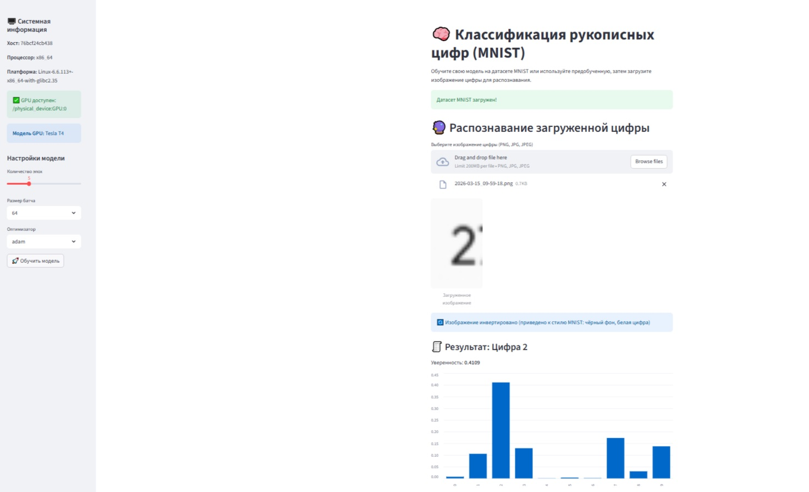
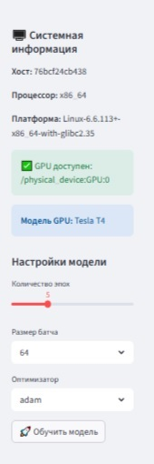
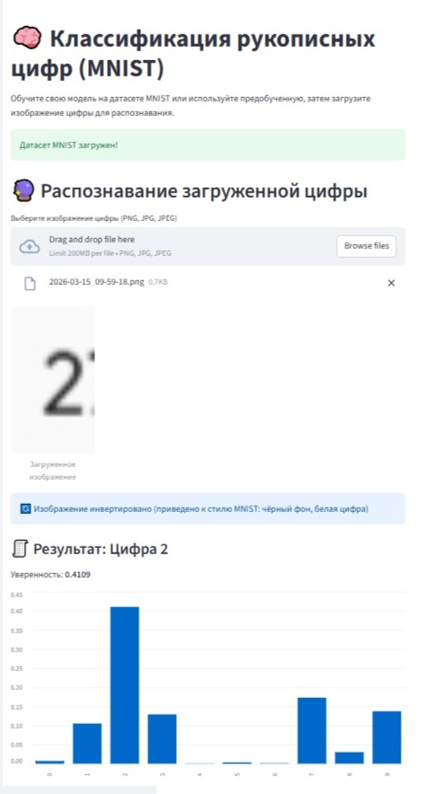

# MNIST Digit Classifier

[](https://www.python.org/)
[](https://www.tensorflow.org/)
[](https://keras.io/)
[](https://streamlit.io/)
[](https://numpy.org/)
[](https://python-pillow.org/)
[](http://yann.lecun.com/exdb/mnist/)
[](LICENSE)

A Streamlit web app that trains a convolutional neural network on the MNIST
handwritten-digit dataset and recognises digits from user-uploaded images.
Hyperparameters (epochs, batch size, optimizer) can be changed in the sidebar,
so the model can be retrained on the fly without editing code.

---

## Note on origin

The project was **originally written in 2024 in Google Colab** as a Jupyter
notebook (`27 (1).py`). It has since been refactored into a plain Python 3.12
Streamlit application, ready to run locally in **Visual Studio Code**.

---

## Example Result

- 📸 Screenshots: `0.jpg`, `1.jpg`, `2.jpg`

<p align="center">
  
</p>

<p align="center">
  
  
</p>

---

## About the Project

| Feature | Where in code | Manual / Library |
|---|---|---|
| System / GPU info in sidebar | `main.py` → *Block 0* | Library (`platform`, `tensorflow`, `subprocess`) |
| MNIST loading & normalisation | `main.py` → `load_mnist()` | Library (`keras.datasets.mnist`) |
| CNN architecture builder | `main.py` → `build_model()` | **Manual** (`keras.Sequential`) |
| Hyperparameter sidebar | `main.py` → *Block 2* | Library (`streamlit`) |
| On-demand retraining | `main.py` → *Block 3* | **Manual** (`model.fit`) + `st.session_state` |
| Baseline auto-training (5 epochs) | `main.py` → *Block 4* | **Manual** |
| Image inference + inversion check | `main.py` → *Block 5* | **Manual** (`numpy`, `PIL`) |
| Model summary & history viewer | `main.py` → *Block 6* | Library (`streamlit.expander`) |

---

## Dataset / Data

| Property | Value |
|---|---|
| Source | Downloaded automatically by Keras from `https://storage.googleapis.com/tensorflow/tf-keras-datasets/mnist.npz` |
| Local cache | `~/.keras/datasets/mnist.npz` (Linux / macOS) · `C:\Users\<user>\.keras\datasets\mnist.npz` (Windows) |
| Format | `.npz` archive with NumPy arrays |
| Size | ~11 MB on disk · 70 000 images total (60 000 train / 10 000 test) · 10 classes (`0`–`9`) |
| Image shape | `28 × 28` pixels, single channel (grayscale), original `uint8` values `0–255` |
| Preprocessing | Pixels scaled to `[0, 1]` (`float32 / 255.0`), channel axis added → shape `(N, 28, 28, 1)` |
| User images | Resized to `28 × 28`, converted to grayscale, **auto-inverted** if the mean brightness is `> 127` (to match MNIST's white-on-black style) |

---

## Model

Convolutional neural network built with `keras.Sequential`:

```
Conv2D(32, 3×3, relu) → BatchNormalization → MaxPooling2D(2×2)
Conv2D(64, 3×3, relu) → BatchNormalization → MaxPooling2D(2×2)
Conv2D(128, 3×3, relu) → BatchNormalization
Flatten → Dense(256, relu) → Dropout(0.5) → Dense(10, softmax)
```

- Loss: `sparse_categorical_crossentropy`
- Optimizer: `adam` by default (also `sgd`, `rmsprop` via sidebar)
- Baseline validation accuracy after 5 epochs on the full 60 000-image set: **> 0.98**

---

## Installation and Run

### 1. Clone the repo

```bash
git clone https://github.com/artrokza-lang/mnist.git
cd mnist
```

### 2. Create a virtual environment

Windows (PowerShell):

```powershell
python -m venv .venv
.venv\Scripts\Activate.ps1
```

Linux / macOS:

```bash
python -m venv .venv
source .venv/bin/activate
```

### 3. Install dependencies

```bash
pip install -r requirements.txt
```

### 4. Run the app

```bash
streamlit run main.py
```

Streamlit will open `http://localhost:8501` in your browser automatically.
On the first run the MNIST archive is downloaded (~11 MB) — subsequent runs
use the local cache.

### 5. Configure secrets (if any)

Not required — the project does not use any API keys or tokens.

---

## Project Structure

```
mnist/
├── main.py            # single-file Streamlit application (Blocks 0–6)
├── requirements.txt   # Python dependencies
├── 0.jpg              # interface screenshot
├── 1.jpg              # interface screenshot
├── 2.jpg              # interface screenshot
└── README.md
```

---

## Requirements

- **Python 3.12** (tested)
- **TensorFlow ≥ 2.16** — earlier versions do not ship wheels for Python 3.12
- **Streamlit ≥ 1.36**
- **NumPy ≥ 1.26**
- **Pillow ≥ 10.3**

See `requirements.txt` for the exact pins.

---

## Troubleshooting

| Symptom | Fix |
|---|---|
| `pip install tensorflow` fails on Python 3.12 | Use `tensorflow>=2.16` — earlier versions have no 3.12 wheels |
| Predictions look random on real photos | The image is likely black-on-white; the app inverts it automatically, but very light/pale digits may need manual contrast |
| `nvidia-smi not found` in sidebar | Harmless — the app runs on CPU. Add NVIDIA `bin` folder to `PATH` if you want GPU detection |

---

## License

Distributed under the **MIT License**. See `LICENSE` for details.
